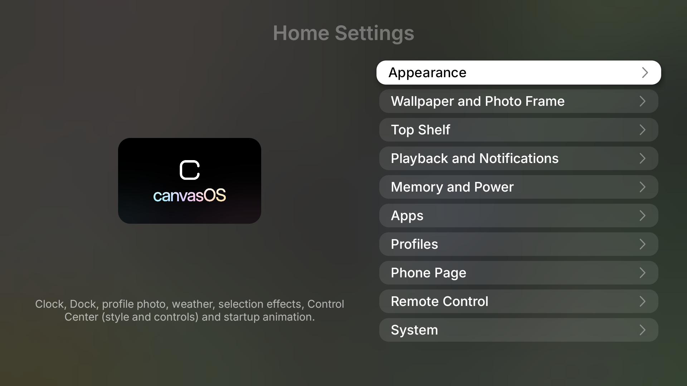
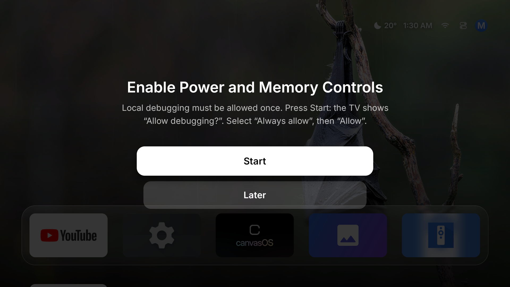
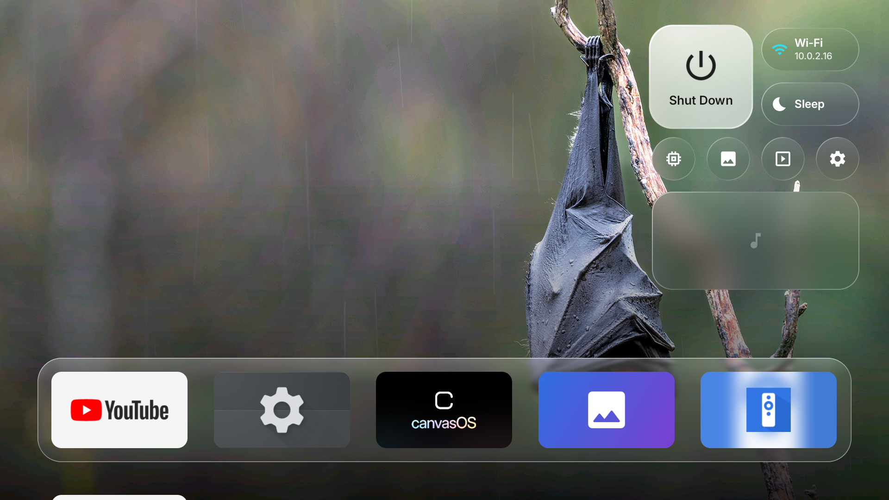

<p align="center"></p>

# canvasOS EN

An English edition of [canvasOS by getisolated](https://github.com/getisolated/canvasOS): a tvOS-inspired home-screen launcher for Android TV and Google TV, based on upstream 1.2.0. This is a launcher app, **not an operating-system image or replacement firmware**. Android 9 (API 28) or later; no root required.

The English edition translates the TV interface, setup prompts, settings, accessibility labels, phone remote page, weather descriptions and errors. English dates, sorting, geocoding, media metadata and wallpaper captions replace French defaults. The streaming-provider discovery region remains France, as upstream; changing language does not change content availability.

- Application ID: `com.aksamitsah.canvasos.en` (separate from upstream).
- Version: `1.2.1`, code `14`.
- Updates: `aksamitsah/canvasOS-EN`, with a dedicated stable signing key.
- Standard APK: `canvasOS.apk`; TCL / app-only variant: `canvasOS-guard.apk`.
- [Installation and agent guide](AGENTS.md) · [Build and release](docs/BUILD_AND_RELEASE.md) · [Project details](docs/PROJECT_DETAILS.md) · [Privacy](docs/PRIVACY.md) · [Source and licensing status](SOURCE_AND_LICENSE.md).
- Original French documentation is preserved in [README.fr.md](README.fr.md) and [AGENTS.fr.md](AGENTS.fr.md).

## English screenshots

Captured from the signed English build in an isolated Android TV 12 emulator, not from a physical Fire TV.



| First-run setup | Control Center |
|---|---|
|  |  |

## Features

- **Home:** large photo background, glass Dock, rounded app tiles, selection effects, folders, pinned HDMI inputs, clock, weather and profile photo.
- **Profiles:** independent app order, hidden apps, folders, app names and wallpaper. Child profiles require a PIN to leave, access settings or remove apps. This does not lock the TV's own settings.
- **Top Shelf:** Continue Watching from Android TV apps, followed by TMDB trends when configured with your key, and supported web feeds.
- **Control Center:** press Back on Home. Power, sleep timer, network, memory cleanup, next photo, photo frame, settings, playback, brightness, inputs, weather and paired Bluetooth devices. Controls can be moved and resized.
- **Wallpapers and screensaver:** Bing, Unsplash with your key, scenery, animals, anime, public-domain art, uploaded photos or custom links. Photos and streaming aerial videos can be used as a screensaver.
- **Phone page:** QR code opens a local remote with trackpad and keyboard, photo uploads, artwork editing, weather, profiles and APK installation. The secret in the address is its access protection.
- **Home Protection:** an accessibility service can return to canvasOS when the stock launcher appears, without uninstalling or disabling it. Availability depends on firmware.
- **Updates:** Home Settings → System → Update; press once to check, again to download and install. Local debugging must be authorized. Daily checks do not download APKs automatically.

## Install

Keep the original launcher installed and enabled. Never turn off, reboot or put a TV to sleep during setup without the owner's agreement. Do not install onto an unidentified network device.

1. Download `canvasOS.apk` from this repository's release. Use `canvasOS-guard.apk` on TVs whose package verifier rejects HOME apps (notably some TCL firmware).
2. Enable developer options and ADB debugging on the TV. Connect the computer and TV to the same network.
3. Connect with `adb connect TV_IP:5555`, then accept the authorization prompt on that TV.
4. Install and open:

```sh
adb -s TV_IP:5555 install -r canvasOS.apk
adb -s TV_IP:5555 shell cmd package set-home-activity com.aksamitsah.canvasos.en/com.aksamitsah.canvasos.en.HomeActivity
adb -s TV_IP:5555 shell am start -n com.aksamitsah.canvasos.en/com.aksamitsah.canvasos.en.HomeActivity
```

Follow [AGENTS.md](AGENTS.md) for the exact grants, local-debugging prompt, Home Protection and recovery steps. Fire TV can ignore the default-home assignment: installation alone does not prove that Home works. Test the Home button and returning from another app. Fire TV compatibility remains unverified until tested on the device.

This APK can coexist with upstream canvasOS. It does **not** update or migrate upstream settings. Future English releases signed with the same English key can update it in place.

## Remote basics

- Arrow keys: move focus. OK: open. Hold OK: context menu.
- Back on Home: Control Center. Back in a page or folder: close or go up.
- Hold an app: rename, hide, move, create/add to folders or app info.
- Home Settings → Phone Page → Show QR Code: phone remote and uploads.
- Do not press OK on Power or Sleep while testing navigation.

## Compatibility

| Device | Expected behavior |
|---|---|
| Android TV / Google TV, Android 9+ | Standard launcher; some firmware requires Home Protection. |
| Sony BRAVIA | Additional brightness, volume and HDMI integration using the TV's IP API after PIN authorization. |
| TCL | Some models require the guard APK, opened as an app with Home Protection. |
| Xiaomi / Redmi | Never disable `com.mitv.tvhome`: this can leave a black screen. |
| Amazon Fire TV | Android-based devices may install the APK, but Home interception and permissions depend on firmware. Test before relying on it. |
| Other TVs / boxes | Brightness and HDMI selection depend on available manufacturer APIs; unsupported controls stay disabled. |

## Recovery

Disable English Home Protection before uninstalling, restore the original screensaver if changed, and then remove only the English package. Keep the recorded original home component and accessibility list. Full instructions are in [AGENTS.md](AGENTS.md#remove-or-restore).

## Development

JDK 17+, Android SDK Platform 36, Build Tools 36.0.0, and the included Gradle wrapper are required.

```sh
./gradlew :app:testStandardDebugUnitTest :app:testGuardDebugUnitTest
./gradlew :app:assembleStandardRelease :app:assembleGuardRelease
./gradlew :app:lintStandardRelease
python3 tools/check-english.py
```

Release signing, CI secrets, checksums and publishing are covered in [docs/BUILD_AND_RELEASE.md](docs/BUILD_AND_RELEASE.md). Never commit signing keys or passwords.

## Attribution

Original canvasOS: **getisolated**, https://github.com/getisolated/canvasOS. This is an independent English derivative, not an official upstream release. Third-party attributions are retained in [THIRD_PARTY_NOTICES.md](THIRD_PARTY_NOTICES.md). Upstream has no top-level license file at the recorded commit; see [SOURCE_AND_LICENSE.md](SOURCE_AND_LICENSE.md) before public distribution.

Not affiliated with or endorsed by Apple, Google, Amazon or Sony. Apple TV and tvOS are Apple trademarks. Upstream's optional Apple title card and film have separate ownership; no ownership of those assets is claimed. Aerial films stream from Apple. Photos, album art and app icons belong to their respective owners.
