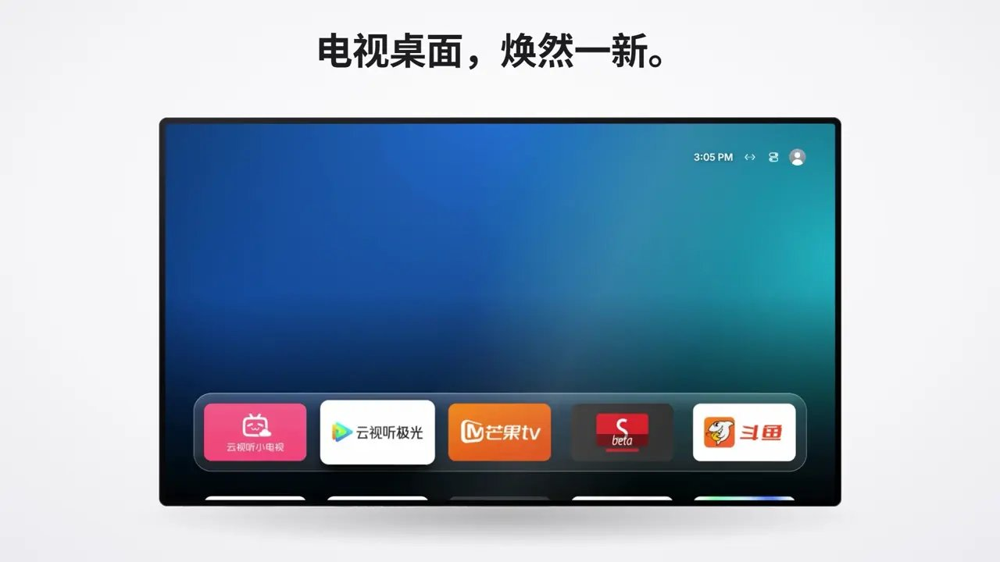
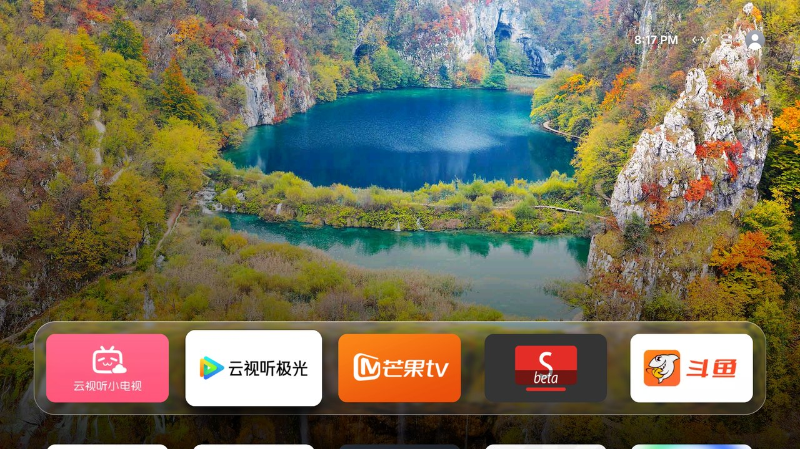
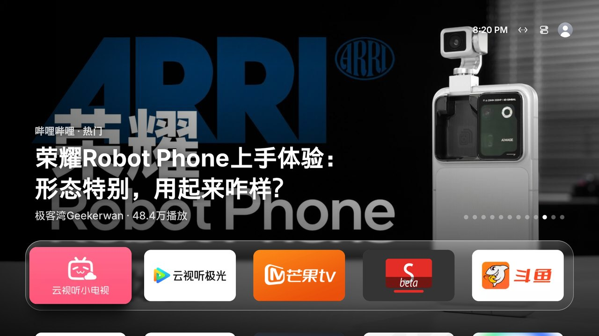
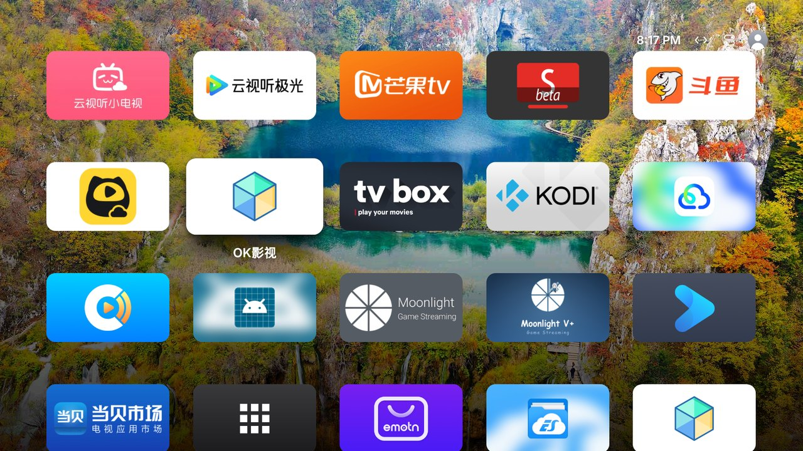

# canvasOS

Donne à l'écran d'accueil d'Android TV l'allure de tvOS 26 : un Dock en Liquid Glass posé en bas de l'écran, du contenu en haut façon Top Shelf, un Centre de contrôle en verre dépoli, des fonds d'écran de paysages et un cadre photo en économiseur d'écran.

**Entièrement validé sur un Sony BRAVIA XR-55A80J (Android TV 12).** Pour les téléviseurs d'autres marques, confiez l'installation et l'adaptation à un agent IA qui suit [AGENTS.md](AGENTS.md) (voir plus bas).



▶ [Voir le film de présentation de 42 secondes](https://canvasos.pages.dev/#film) (lu sur le site d'origine, avec le son)

## Captures d'écran



| Contenu du haut (Top Shelf) | Toutes les apps |
|---|---|
|  |  |
| **Centre de contrôle** | **Cadre photo / économiseur** |
|  |  |

## Faire installer canvasOS par un agent IA

### Étape 1 : activer le débogage ADB sur le téléviseur

L'ordinateur et le téléviseur doivent être sur le même réseau. Trouvez d'abord l'adresse IP du téléviseur (en général dans Paramètres → Réseau, ou dans « À propos »), puis activez ADB :

| Téléviseur | Comment l'activer |
|---|---|
| **Xiaomi / Redmi** | Réglages (设置) → À propos (关于) → **Modèle du produit (产品型号)** : appuyez plusieurs fois sur OK jusqu'à ce que le mode développeur soit annoncé comme activé. Puis Réglages (设置) → Compte et sécurité (账号与安全) : activez **Débogage ADB (ADB 调试)** et **Installer des apps de sources inconnues (安装未知来源的应用)** |
| **TCL / FFalcon (雷鸟)** | Réglages (设置) → À propos (关于) → **Informations sur l'appareil (本机信息)**, puis appuyez sur **Haut, Bas, Gauche, Droite** sur la télécommande, à moins d'une seconde d'intervalle. Un groupe « Plus (更多) » apparaît en bas : activez **ADB** dedans |
| **Sony BRAVIA** | Paramètres → Système → À propos → appuyez 7 fois sur OK sur **Build** (version d'Android TV OS) ; puis Paramètres → Système → Options pour les développeurs → activez **Débogage USB** |
| **Android TV / Google TV d'origine**, Hisense et autres | Paramètres → Préférences de l'appareil → À propos → appuyez 7 fois sur **Build** ; puis activez **Débogage USB** dans les Options pour les développeurs (parfois appelé « Débogage réseau » ou « Débogage ADB ») |

À la première connexion de l'ordinateur, le téléviseur demande « Autoriser le débogage USB ? » (« 允许 USB 调试吗？ » sur les téléviseurs chinois) : choisissez **Autoriser** (允许) et cochez « Toujours autoriser » (始终允许). Xiaomi désactive ADB à chaque sortie de veille ; une fois canvasOS installé, vous pouvez activer « Garder le débogage ADB activé » dans les réglages.

### Étape 2 : confier la suite à l'agent

Ce dépôt est privé : l'agent (Codex, Claude Code ou tout autre agent capable d'exécuter des commandes) doit avoir accès au dépôt, soit via un clone local, soit via la CLI GitHub (`gh`) connectée à un compte autorisé. Envoyez-lui simplement cette phrase :

> Installe canvasOS sur ma télé en suivant le AGENTS.md de https://github.com/getisolated/canvasOS ; l'IP de la télé est 192.168.x.x

L'agent suit [AGENTS.md](AGENTS.md) étape par étape : connexion au téléviseur, installation, définition comme écran d'accueil par défaut, autorisations, et configuration supplémentaire pour les téléviseurs Sony. En cours de route, le téléviseur affiche deux ou trois fenêtres de confirmation : choisissez « Autoriser » avec la télécommande. Sur un téléviseur TCL, le message « Interaction multi-écrans : envoi d'une application en cours » (多屏互动：正在发起应用推送) apparaît : choisissez « Accepter » (同意).

## Fonctionnalités

- **Accueil** : en haut à droite, l'heure, le réseau et une photo de profil par défaut façon Apple (désactivable) ; sélectionner la photo de profil ouvre Réglages de l'accueil. En bas, des icônes 16:9 aux coins arrondis sur 5 colonnes. Comme sur tvOS, l'icône sélectionnée grossit avec un effet élastique, s'incline dans le sens du déplacement, un reflet glisse sur sa surface et elle projette une ombre. L'heure peut s'afficher en 12 h ou 24 h, en haut à droite, en grande horloge avec la date en haut à gauche, ou pas du tout.
- **Réglages de l'accueil** : une mise en page inspirée des réglages de tvOS, avec à gauche une grande icône et la description de l'option sélectionnée, et à droite les options regroupées. Chaque effet visuel peut être désactivé séparément ; « Effet de sélection » et « Style du Centre de contrôle » sont sur « Auto » par défaut, ce qui choisit un style plus léger sur les téléviseurs peu puissants (moins de 2,5 Go de mémoire, Android antérieur à 10, ou moins de 4 cœurs).
- **La dernière app ouverte passe en premier** : après l'ouverture réussie d'une app depuis l'accueil, elle passe automatiquement en première position ; les autres icônes gardent leur ordre, même après un redémarrage. Un échec d'ouverture, un simple déplacement de la sélection ou un changement d'entrée HDMI ne modifient pas l'ordre.
- **Modifier l'accueil** : un appui long sur une icône ouvre le mode édition ; déplacez-la avec les flèches. À la prochaine ouverture de cette app, elle repassera quand même en premier.
- **Supprimer des apps, y compris préinstallées** : le menu d'appui long permet de supprimer directement une app, même une app préinstallée que les réglages du téléviseur ne laissent pas supprimer (`pm uninstall --user 0` ; le paquet reste sur la partition système). Une app préinstallée supprimée n'apparaît plus et ne tourne plus en arrière-plan ; vous pouvez la restaurer à tout moment dans Réglages de l'accueil → Apps préinstallées supprimées. Les composants indispensables au téléviseur (réglages, lecteur TV, sources d'entrée, écran d'accueil) ne peuvent pas être supprimés.
- **Dock Liquid Glass** : la première rangée d'apps repose sur une plaque de verre posée en bas de l'écran ; seul le bord supérieur de la rangée suivante dépasse, et la flèche du bas déploie toutes les apps. Le flou, la réfraction des bords et les reflets colorés du verre sont précalculés sur le CPU à partir du fond d'écran actuel (Android 12 n'a pas de shaders à l'exécution) : le défilement ne sollicite donc pas davantage le GPU.
- **Contenu du haut** : quand certaines apps du Dock sont sélectionnées, la moitié supérieure de l'écran fait défiler leur contenu :
  - 云视听小电视 (Bilibili TV) : vidéos populaires de Bilibili
  - 斗鱼 (Douyu) : les directs les plus suivis du moment

  Le contenu vient des interfaces web publiques de ces deux services, car les apps chinoises n'alimentent pratiquement jamais les chaînes système d'Android TV.
- **Centre de contrôle** (touche Retour de la télécommande ou bouton en haut à droite) : des boutons en verre liquide flottant séparément, sans plaque de fond, qui laissent voir l'accueil flouté derrière eux (capturé une fois à l'ouverture, donc identique quelle que soit la version du système) ; le bouton sélectionné éclaire ses voisins. Vous pouvez aussi revenir à l'ancien panneau sombre, plus léger. On y trouve Réseau, Veille, Éteindre, Redémarrer, Libérer la mémoire, Cadre photo et Réglages, ainsi que la luminosité, le volume et la source HDMI.
- **Animation de démarrage** (désactivée par défaut) : au premier affichage de l'accueil après le démarrage, une vidéo est lue en plein écran ; le logo final s'agrandit et l'on entre dans l'accueil à travers lui, comme au démarrage d'une Apple TV. N'importe quelle touche la passe. Elle peut se jouer seulement au démarrage, ou au démarrage et à la sortie de veille. La vidéo n'est pas fournie avec l'app : importez-la depuis la page ouverte par le QR code (voir « Fond d'écran ») ; l'idéal est une courte vidéo qui se termine sur un logo sur fond noir, logo qui est détouré automatiquement de la dernière image. Vous pouvez aussi choisir l'animation du logo canvasOS (utilisée aussi quand aucune vidéo n'est importée).
- **Fonds d'écran** : la photo du jour de Bing (Photos du jour), Paysages et Animaux mignons (fonds 360), les fonds Anime les plus populaires du mois sur Wallhaven (tout public uniquement ; une source chinoise prend le relais si Wallhaven est inaccessible), Chefs-d'œuvre (œuvres du domaine public de Wallhaven et du Cleveland Museum of Art). Les photos ne sont téléchargées qu'au moment de leur affichage (une petite douzaine par source et par jour au maximum), celles de plus de 3 jours sont supprimées automatiquement, et une source inutilisée ne garde qu'un aperçu. Le fond peut changer toutes les 15 minutes à une fois par jour ; vous pouvez aussi choisir un dégradé de couleur. Le cadre photo suit la source choisie.
- **Fond d'écran** : la tuile « Fond d'écran » de l'accueil (ou Réglages → Fond d'écran) présente tous les fonds sous forme d'aperçus : un seul appui suffit pour changer. À droite, un QR code ; scanné avec un téléphone, il ouvre une page web pour :
  - importer des photos du téléphone, qui servent de fond « Mes photos » et d'économiseur ;
  - saisir vos propres liens d'images (un par ligne), que le téléviseur récupère chaque jour : l'adresse d'une image, une API d'images aléatoires qui renvoie une image différente à chaque appel, ou une page web / un JSON qui liste des adresses d'images ;
  - choisir le fond d'écran et l'économiseur ;
  - importer la vidéo de l'animation de démarrage, choisir quand la jouer, et entre la vidéo et le logo canvasOS ;
  - remplacer l'icône de Réglages de l'accueil par votre propre image (l'icône sur l'accueil et la grande image de la page des réglages), avec retour possible à l'engrenage par défaut.

  La page n'est accessible que pendant que cet écran est ouvert (et 5 minutes après) ; son adresse contient un jeton aléatoire, impossible à deviner pour les autres appareils du réseau local.
- **Cadre photo / économiseur** : diaporama plein écran avec un lent mouvement de panoramique et de zoom ; l'heure change régulièrement de place pour éviter le marquage des écrans OLED. Vous pouvez aussi choisir les **Vues aériennes (Apple TV)** (lues en streaming depuis les serveurs d'Apple, avec le nom du lieu qui change selon le plan ; flèches gauche/droite pour changer de vidéo ; retour automatique aux photos sans connexion). Le cadre s'ouvre à la main ou sert d'économiseur système : dans Réglages de l'accueil → Délai avant le cadre photo, choisissez de 1 à 30 minutes ; sans appui sur la télécommande pendant ce délai, le cadre photo s'affiche (sauf pendant la lecture d'une vidéo).
- **Entrées HDMI sur l'accueil** : Centre de contrôle → Source → « Afficher sur l'accueil… » ; les sources choisies deviennent des icônes de l'accueil, un appui suffit pour basculer dessus.
- **Protection de l'accueil** (Xiaomi, TCL et autres téléviseurs chinois) : voir plus bas.
- **Nettoyage de la mémoire** : nettoyage périodique, et une fois de plus quand le téléviseur passe en veille ; la liste des apps à conserver se modifie dans les réglages.

## Quelles fonctions marchent sur tous les téléviseurs

| Fonction | Tout Android TV (Android 9+) | Nécessite le débogage local | Sony BRAVIA uniquement |
|---|:-:|:-:|:-:|
| Accueil, Dock, effets de verre, ombres | ✅ | | |
| Contenu du haut (Bilibili / Douyu) | ✅ avec l'app TV correspondante installée | | |
| Fonds Paysages / Anime, cadre photo | ✅ | | |
| Interface du Centre de contrôle, horloge | ✅ | | |
| Libérer la mémoire | ✅ caches uniquement | ✅ arrêt complet des apps en arrière-plan | |
| Supprimer des apps préinstallées | | ✅ | |
| Veille, extinction, redémarrage | | ✅ | |
| Cadre photo en économiseur système, délai d'inactivité | | ✅ | |
| Curseur de volume | ✅ volume Android standard | | ✅ volume du téléviseur |
| Changement de source HDMI | ✅ la plupart des téléviseurs | | ✅ affiche aussi la source actuelle |
| Curseur de luminosité (rétroéclairage) | Xiaomi (autorisation ADB requise) | | ✅ |
| Protection de l'accueil, relance automatique après arrêt forcé | autorisation ADB une fois depuis l'ordinateur, ou débogage local | ✅ | |

- **Débogage local** : l'app se connecte à l'adb du téléviseur lui-même (`127.0.0.1:5555`, via [dadb](https://github.com/mobile-dev-inc/dadb)) pour exécuter des commandes système. Il faut que le « Débogage réseau / Débogage ADB » soit activé dans les options pour les développeurs. À la première utilisation, le téléviseur affiche « Autoriser le débogage ? » : cochez « Toujours autoriser ». Ce mécanisme fonctionne sur toutes les marques.
- **Sony** : quand le téléviseur expose l'interface de contrôle IP BRAVIA (`http://127.0.0.1/sony/`), la luminosité, le volume et les sources passent par elle.
- **TCL / FFalcon, firmware chinois** (validé sur un FFalcon 75R685C) : le système n'enregistre pas de sources d'entrée standard ; la ligne Source ouvre donc le sélecteur de source de TCL, « Réglages du téléviseur » ouvre les réglages TCL, et faute d'interface de rétroéclairage utilisable, le curseur de luminosité est masqué. Ces firmwares refusent `adb install` (`INSTALL_FAILED_VERIFICATION_FAILURE`). Si un autre lanceur tiers reste activé, un choix d'écran d'accueil peut s'afficher après un démarrage à froid : désactivez-le avec `pm disable-user`.
- **Xiaomi / Redmi, firmware chinois** (porté d'après les notes de modèles d'[Aerial](https://github.com/pengchujin/aerial-tv), non testé sur un vrai téléviseur) : le rétroéclairage passe par `picture_backlight`, les sources par le lecteur Xiaomi, « Réglages du téléviseur » et le Wi-Fi ouvrent les réglages de Xiaomi ; les apps système sans point d'entrée standard (boutique d'apps Xiaomi, lecteur HD, Mi Home) apparaissent aussi sur l'accueil. Xiaomi affiche son propre économiseur (avec publicité) au lieu de celui d'Android : canvasOS ouvre le cadre photo 15 secondes avant qu'il n'apparaisse.
- **Autres marques** : canvasOS utilise les interfaces standard d'Android. Le volume passe par `AudioManager` ; pour les sources, `TvInputManager` liste les ports HDMI, puis le lecteur TV du système effectue le changement. Android n'a pas d'interface standard pour le rétroéclairage : le curseur de luminosité est donc masqué. Avec un amplificateur (ARC/eARC), le volume standard peut régler le téléviseur lui-même et non l'amplificateur.

### Téléviseurs chinois (système qui n'est pas Android TV d'origine) : protection de l'accueil

Xiaomi, TCL, Hisense, Skyworth et la plupart des téléviseurs chinois n'acceptent que leur propre écran d'accueil : sur Xiaomi, `set-home-activity` annonce un succès mais n'a aucun effet, et la touche Accueil ramène toujours à PatchWall ; en veille, le système force en plus l'arrêt de toutes les apps tierces. **Ne désactivez surtout pas le lanceur d'origine de Xiaomi** (`com.mitv.tvhome`), sinon l'écran reste noir au démarrage.

La méthode de canvasOS reprend celle qu'[Aerial](https://github.com/pengchujin/aerial-tv) a validée sur de vrais téléviseurs Xiaomi et TCL : pas de root, et aucune app système désinstallée ou désactivée :

1. **Protection de l'accueil** (service d'accessibilité « Protection de l'accueil ») : dès que le lanceur d'origine passe au premier plan, canvasOS revient devant (le lanceur d'origine reste visible environ une demi-seconde). Le service ne surveille que les changements de fenêtre et ne lit jamais le contenu de l'écran. Au démarrage ou à la sortie de veille, il attend 1,5 seconde, pour ne pas interrompre une console ou un boîtier qui bascule la source via HDMI-CEC. L'icône du lanceur d'origine sur l'accueil permet toujours de l'ouvrir.
2. **Relance après arrêt forcé** : un écouteur de notifications est enregistré (aucune notification n'est lue). Environ une demi-seconde après que le système a tué canvasOS, Android le relie à nouveau : canvasOS redémarre alors et réactive la protection. C'est aussi lui qui lance canvasOS au démarrage.
3. **Garder ADB activé** (facultatif) : Xiaomi désactive le débogage ADB à la sortie de veille ; canvasOS le réactive aussitôt, ce qui facilite les mises à jour ultérieures.
4. **TCL** : TCL refuse tout `adb install`, ainsi que toute app qui se déclare écran d'accueil. Il existe donc une **version guard** (`canvasOS-guard.apk`, qui ne se déclare pas écran d'accueil et reste au premier plan grâce à la protection), installée via l'« Interaction multi-écrans » (多屏互动) intégrée au téléviseur ([`tools/tcast-push.py`](tools/tcast-push.py)) : il suffit de choisir une fois « Accepter » (同意) sur le téléviseur. TCL bloque par défaut le lancement automatique des apps tierces au démarrage ; l'installation les autorise avec `appops`.

La protection est désactivée par défaut. Lors de l'installation, l'agent accorde les autorisations et l'active en suivant [AGENTS.md](AGENTS.md#10-protection-de-laccueil-téléviseurs-qui-rejettent-les-lanceurs-tiers) ; vous pouvez aussi l'activer vous-même dans Réglages → Protection de l'accueil (après avoir autorisé le débogage local). Cette option n'apparaît que sur Xiaomi, TCL ou les téléviseurs où canvasOS n'est pas l'écran d'accueil par défaut, et « Garder le débogage ADB activé » uniquement sur Xiaomi ; sur Sony et les autres Android TV d'origine, elles sont absentes. Les parties Xiaomi et TCL ont été portées d'après les notes d'Aerial sur de vrais appareils ; l'auteur d'origine ne possède aucun de ces deux téléviseurs, n'hésitez pas à ouvrir une issue en cas de problème.

Autorisations à accorder depuis l'ordinateur via ADB :

| Autorisation | Usage |
|---|---|
| `WRITE_SECURE_SETTINGS` | Réactiver la protection quand le système la coupe ; garder le cadre photo comme économiseur système ; garder ADB activé ; écrire la valeur de rétroéclairage de Xiaomi |
| Écouteur de notifications | Relance par le système après un arrêt forcé ou au démarrage ; aucune notification n'est lue |
| Superposition (`SYSTEM_ALERT_WINDOW`) | Ouvrir l'écran d'accueil depuis l'arrière-plan après le démarrage |
| TCL `APP_AUTO_START` / `APP_ASSOC_START` | Autoriser le lancement au démarrage (TCL uniquement) |

### Adapter canvasOS à d'autres marques

Ces trois fonctions (luminosité, volume, sources) se trouvent dans le dossier [`tv/`](app/src/main/java/com/leslie/tvhome/tv/), avec un adaptateur par marque :

```
tv/
├── TvControls.kt      # aiguillage : choisit le premier adaptateur qui reconnaît le téléviseur
├── AndroidAdapter.kt  # interface commune + implémentation Android standard, dont héritent toutes les marques
├── SonyAdapter.kt
├── TclAdapter.kt
├── XiaomiAdapter.kt
└── CoocaaAdapter.kt   # Coocaa / Skyworth : seules les sources sont adaptées, pas encore testé sur un vrai téléviseur
```

Pour prendre en charge une nouvelle marque, créez `<Marque>Adapter.kt` qui hérite d'`AndroidAdapter`, ne redéfinissez que ce qui diffère pour cette marque (le rétroéclairage, par exemple), puis ajoutez-le à la liste de `TvControls`. Ce qui n'est pas redéfini passe automatiquement par les interfaces Android standard.

Pas besoin de savoir coder. Envoyez cette phrase à un agent : en suivant [la section « Adapter » d'AGENTS.md](AGENTS.md#9-adapter-canvasos-à-un-téléviseur-mal-pris-en-charge), il cherchera les interfaces disponibles sur votre téléviseur, modifiera le code, compilera, installera et vérifiera :

> Installe canvasOS en suivant le AGENTS.md de https://github.com/getisolated/canvasOS, et si la luminosité, le volume ou les sources ne marchent pas sur ma télé, adapte-le. L'IP de la télé est 192.168.x.x

## Compiler et installer à la main

Il faut JDK 17 et le SDK Android (compileSdk 36). Vous pouvez aussi télécharger les APK des [Releases](https://github.com/getisolated/canvasOS/releases/latest) ; le dépôt étant privé, le plus simple est la CLI GitHub, connectée à un compte qui a accès au dépôt :

```sh
gh release download --repo getisolated/canvasOS --pattern canvasOS.apk
```

Pour compiler et installer :

```sh
./gradlew assembleStandardRelease assembleGuardRelease
adb connect <IP_du_téléviseur>:5555
adb install -r app/build/outputs/apk/standard/release/app-standard-release.apk
adb shell cmd package set-home-activity com.leslie.tvhome/.HomeActivity   # définir comme écran d'accueil par défaut
```

Les Releases contiennent deux APK : `canvasOS.apk` (version standard) et `canvasOS-guard.apk` (pour TCL, ne se déclare pas écran d'accueil).

**Signature et mises à jour** : les APK sont compilés par GitHub Actions et signés avec la clé debug jetable du runner ; chaque version a donc une signature différente. `adb install -r` échoue alors avec `INSTALL_FAILED_UPDATE_INCOMPATIBLE` : pour mettre à jour, désinstallez d'abord l'app avec `adb uninstall com.leslie.tvhome`. Cela efface les réglages et les autorisations : refaites ensuite l'étape 4 et l'étape 6 d'[AGENTS.md](AGENTS.md).

Sur un téléviseur Sony, pour la luminosité, le volume et les sources, il faut aussi enregistrer une fois le client BRAVIA :

```sh
BODY='{"method":"actRegister","id":1,"version":"1.0","params":[{"clientid":"tvhome:1","nickname":"TVHome","level":"private"},[{"value":"yes","function":"WOL"}]]}'
curl -s http://<IP_du_téléviseur>/sony/accessControl -d "$BODY"              # le téléviseur affiche un code PIN à 4 chiffres
curl -s -u ":<PIN>" http://<IP_du_téléviseur>/sony/accessControl -d "$BODY"  # termine l'enregistrement avec ce PIN
```

Une fois enregistrée, l'app renouvelle l'autorisation toute seule. L'identifiant client est fixe ; seuls les appareils de votre réseau local peuvent l'utiliser, il n'est pas accessible depuis Internet.

### Publier une version

Les versions sont publiées par GitHub Actions : poussez un tag commençant par `v`, et le workflow compile les deux APK et crée la Release correspondante.

```sh
git tag v1.0.0 && git push origin v1.0.0
```

## Mentions tierces

Les licences des polices, icônes et dépendances tierces figurent dans [THIRD_PARTY_NOTICES.md](THIRD_PARTY_NOTICES.md).

La protection de l'accueil, l'installation via l'Interaction multi-écrans de TCL, la liste des vues aériennes de l'Apple TV et la page de réglages sur téléphone s'inspirent d'[Aerial](https://github.com/pengchujin/aerial-tv) (MIT, © 2026 pengchujin) et en reprennent du code ; les détails des modèles Xiaomi et TCL viennent aussi de ses notes sur de vrais appareils. Merci.

Ce projet n'est affilié ni à Apple, ni à Sony, ni à Xiaomi, ni à TCL, ni à Bilibili, ni à Douyu. Les vues aériennes sont fournies par les serveurs d'Apple ; ce projet ne contient aucun fichier vidéo. Les droits des pochettes et photos visibles sur les captures d'écran appartiennent à leurs auteurs respectifs.

## Recopie d'écran recommandée

canvasOS n'intègre pas de recopie d'écran. Nous recommandons d'installer sur le téléviseur [Miracast Receiver](https://github.com/weekdayjast/MiracastReceiver) (MIT), libre, gratuit et sans publicité : il prend en charge AirPlay depuis iPhone / iPad / Mac, la diffusion DLNA depuis les apps vidéo des téléphones (Bilibili, Youku, iQIYI, etc.) et Emby, ainsi que la recopie sans fil Miracast intégrée à Windows et Android (root nécessaire sur certains téléviseurs). Téléchargez dans ses Releases l'APK correspondant au processeur du téléviseur (`adb shell getprop ro.product.cpu.abi` ; pour un téléviseur 32 bits, prenez armeabi-v7a), installez-le avec `adb install`, et à la première ouverture autorisez l'accès à la position (nécessaire pour découvrir les appareils en Wi-Fi Direct). Il peut lancer son service de réception au démarrage, et Libérer la mémoire de canvasOS ne le ferme pas par défaut.
